<a href="mailto:sf@innolope.com"><picture><source media="(prefers-color-scheme: dark)" srcset="assets/header-dark.svg">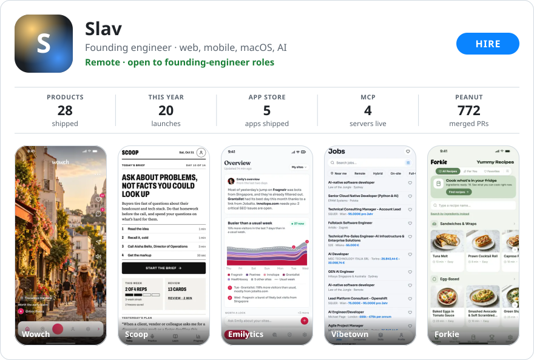</picture></a>

## I take a product from empty repo to the App Store, then keep it running.

Looking for a **founding or first-engineer role** on a small, fully remote team that ships fast. I've built mobile apps, AI tools with MCP servers, data pipelines and native Mac apps, and I handle security and payments work on a live fintech product.

<a href="mailto:sf@innolope.com"><picture><source media="(prefers-color-scheme: dark)" srcset="assets/btn-contact-dark.svg"></picture></a>&nbsp;<a href="https://www.linkedin.com/in/slavikfokin/"><picture><source media="(prefers-color-scheme: dark)" srcset="assets/btn-linkedin-dark.svg"></picture></a>&nbsp;<a href="https://innolope.com"><picture><source media="(prefers-color-scheme: dark)" srcset="assets/btn-site-dark.svg"></picture></a>

<picture><source media="(prefers-color-scheme: dark)" srcset="assets/why-dark.svg">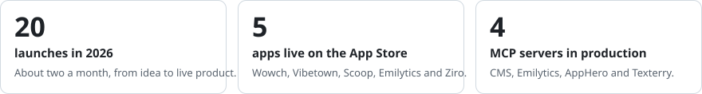</picture>

### Projects by area

[Mobile apps](#mobile-apps) (4) · [AI tools & MCP servers](#ai-tools--mcp-servers) (4) · [Data pipelines](#data-pipelines) (3) · [Mac apps](#mac-apps) (3) · [Web products](#web-products) (2) · [Fintech & security](#fintech--security) (1)

### Mobile apps

Expo and React Native apps on the App Store and Google Play.

<a href="https://wooowch.com"><picture><source media="(prefers-color-scheme: dark)" srcset="assets/card-wowch-dark.svg">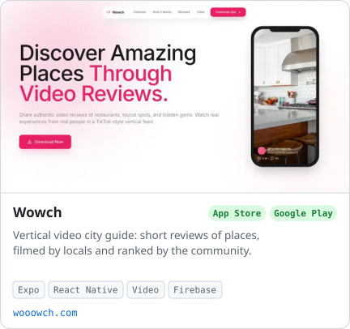</picture></a> <a href="https://vibetown.pro"><picture><source media="(prefers-color-scheme: dark)" srcset="assets/card-vibetown-dark.svg">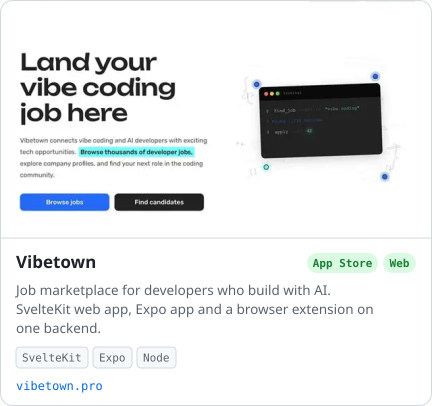</picture></a> 
<a href="https://apps.apple.com/us/app/scoop-conversation-practice/id6828656782"><picture><source media="(prefers-color-scheme: dark)" srcset="assets/card-scoop-dark.svg">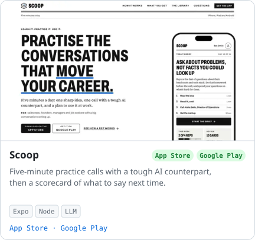</picture></a> <a href="https://4kie.com"><picture><source media="(prefers-color-scheme: dark)" srcset="assets/card-forkie-dark.svg">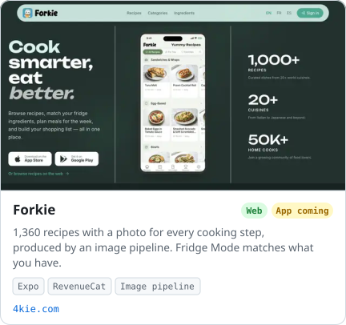</picture></a> 

### AI tools & MCP servers

Products that AI agents use directly over MCP.

<a href="https://github.com/Innolope/innolope-cms"><picture><source media="(prefers-color-scheme: dark)" srcset="assets/card-cms-dark.svg">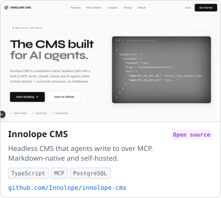</picture></a> <a href="https://emilytics.com"><picture><source media="(prefers-color-scheme: dark)" srcset="assets/card-emilytics-dark.svg">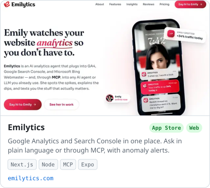</picture></a> 
<a href="https://apphero.online"><picture><source media="(prefers-color-scheme: dark)" srcset="assets/card-apphero-dark.svg">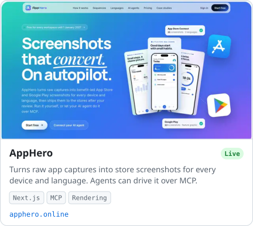</picture></a> <a href="https://documenda.innolope.com"><picture><source media="(prefers-color-scheme: dark)" srcset="assets/card-documenda-dark.svg">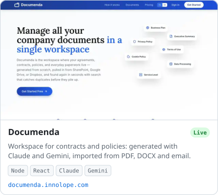</picture></a> 

### Data pipelines

Raw public data collected, cleaned and turned into products people search.

<a href="https://tinyworld.online"><picture><source media="(prefers-color-scheme: dark)" srcset="assets/card-tinyworld-dark.svg">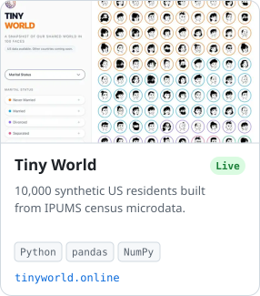</picture></a> <a href="https://innolope.com/pulse"><picture><source media="(prefers-color-scheme: dark)" srcset="assets/card-pulse-dark.svg">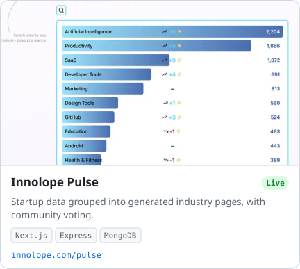</picture></a> <a href="https://techfeed.online"><picture><source media="(prefers-color-scheme: dark)" srcset="assets/card-techfeed-dark.svg">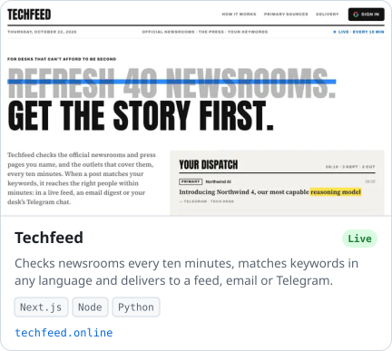</picture></a> 

### Mac apps

Desktop apps for macOS: screen capture, messaging, menu bar.

<a href="https://texterry.com"><picture><source media="(prefers-color-scheme: dark)" srcset="assets/card-texterry-dark.svg">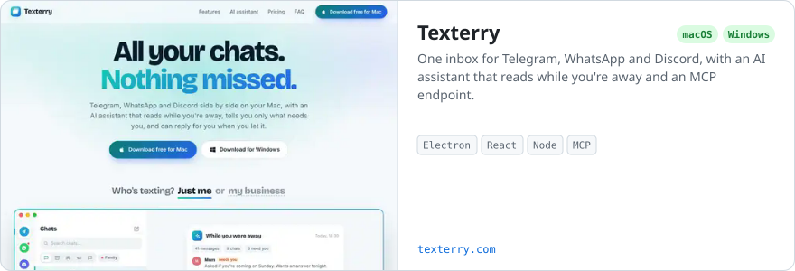</picture></a> <a href="https://bergman.digital"><picture><source media="(prefers-color-scheme: dark)" srcset="assets/card-bergman-dark.svg">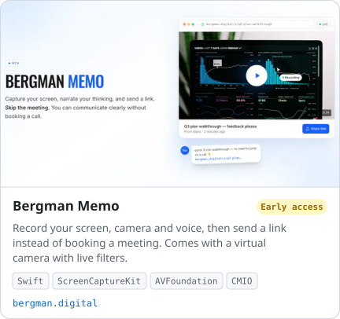</picture></a> <a href="https://github.com/Innolope/LimitFuel"><picture><source media="(prefers-color-scheme: dark)" srcset="assets/card-limitfuel-dark.svg">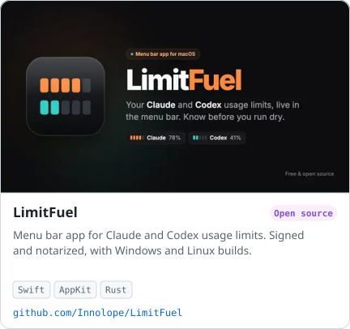</picture></a> 

### Web products

Consumer sites with search, catalogues and browser extensions.

<a href="https://jobalto.com"><picture><source media="(prefers-color-scheme: dark)" srcset="assets/card-jobalto-dark.svg"></picture></a> <a href="https://fragnoir.com"><picture><source media="(prefers-color-scheme: dark)" srcset="assets/card-fragnoir-dark.svg">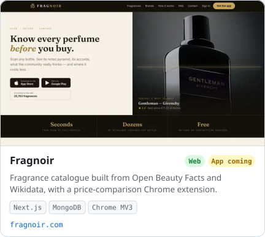</picture></a> 

### Fintech & security

Production code that moves real money, on web and native.

<a href="https://peanut.me"><picture><source media="(prefers-color-scheme: dark)" srcset="assets/card-peanut-dark.svg">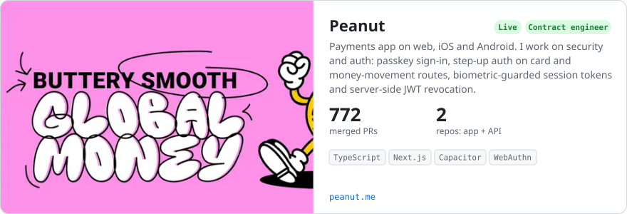</picture></a> 

### Shipping cadence

<picture><source media="(prefers-color-scheme: dark)" srcset="assets/cadence-dark.svg"></picture>

### Hard parts

<b>Bergman Memo</b>: long screen recordings that never lose the file

**Problem.** AVAssetWriter throws away the whole file on a single out-of-order timestamp, and a full disk used to fail silently in the middle of a recording.

**Solution.** Every frame passes through a monotonic timeline, mic and system audio are mixed on one sample clock, and a disk guard warns before space runs out.

**Stack.** Swift, ScreenCaptureKit, AVFoundation

<b>Tiny World</b>: synthetic people that look like real census data

**Problem.** Sampling each attribute on its own gives impossible people, such as a teenage surgeon on a high income.

**Solution.** Records are drawn from IPUMS ACS microdata so income, education, age and occupation stay consistent, then checked against a JSON Schema.

**Stack.** Python, pandas, NumPy

<b>Peanut</b>: auth that works the same in a browser and a native app

**Problem.** Passkeys, cookies and keychains all behave differently in a browser, an iOS wrapper and an Android wrapper, and the app moves real money.

**Solution.** Step-up auth on card and money-movement routes, server-side JWT revocation with a per-user token version, and session tokens held in Keychain or Keystore behind biometrics.

**Stack.** TypeScript, Next.js, Capacitor, WebAuthn

---

**Hiring your first engineers?** Small team, remote, lots of ownership: that's the job I'm looking for.

<a href="mailto:sf@innolope.com"><picture><source media="(prefers-color-scheme: dark)" srcset="assets/btn-contact-dark.svg"></picture></a>&nbsp;<a href="https://www.linkedin.com/in/slavikfokin/"><picture><source media="(prefers-color-scheme: dark)" srcset="assets/btn-linkedin-dark.svg"></picture></a>

sf@innolope.com · [linkedin.com/in/slavikfokin](https://www.linkedin.com/in/slavikfokin/)
